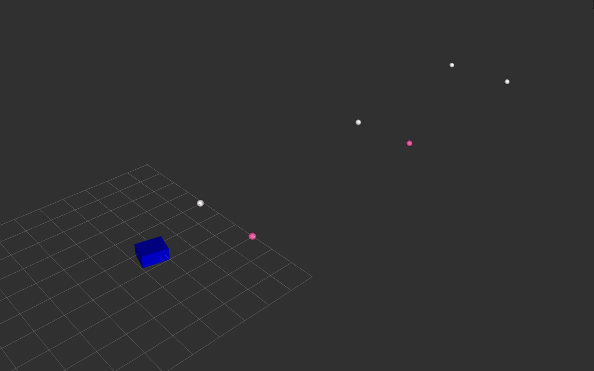

# Environment Estimator

The main goal of this package is to receive detected objects by selene and use a KF to estimate the current and the future states of the map.





## Role in the Selene stack

This ROS 2 C++ package turns camera detections into a tracked environment model for autonomous missions. It receives `object_msgs/Object` on `selene/object_detector/object`, transforms detections into the world frame, associates repeated observations and handles static and dynamic objects, including Kalman-filter state estimation.

[ObjectManager](src/ObjectManager.cpp) publishes `object_msgs/Buoys` on `selene/environment_estimator/buoys` and `object_msgs/Boats` on `selene/environment_estimator/boats`. The package also contains an environment visualizer.

It depends on [object_msgs](https://github.com/Sub-Horizon-NTNU/object_msgs), detections from [usv_object_detector](https://github.com/Sub-Horizon-NTNU/usv_object_detector) or a simulator, and the boat/camera transforms. Its outputs are consumed by [usv_mission_package](https://github.com/Sub-Horizon-NTNU/usv_mission_package).

## Build and configuration

Place the package and its dependencies in a sourced ROS 2 workspace, then build from the workspace root:

```sh
colcon build --packages-up-to environment_estimator
source install/setup.bash
```

The entry point is `ros2 launch environment_estimator environment_estimator.launch.py`. [Launch arguments](launch/environment_estimator.launch.py) include `field_of_view` (72 degrees), `min_radius` (0.75 m), `max_radius` (20 m) and `simulator_mode` (false). Simulator mode changes how detection coordinates are transformed; it does not start a simulator.
